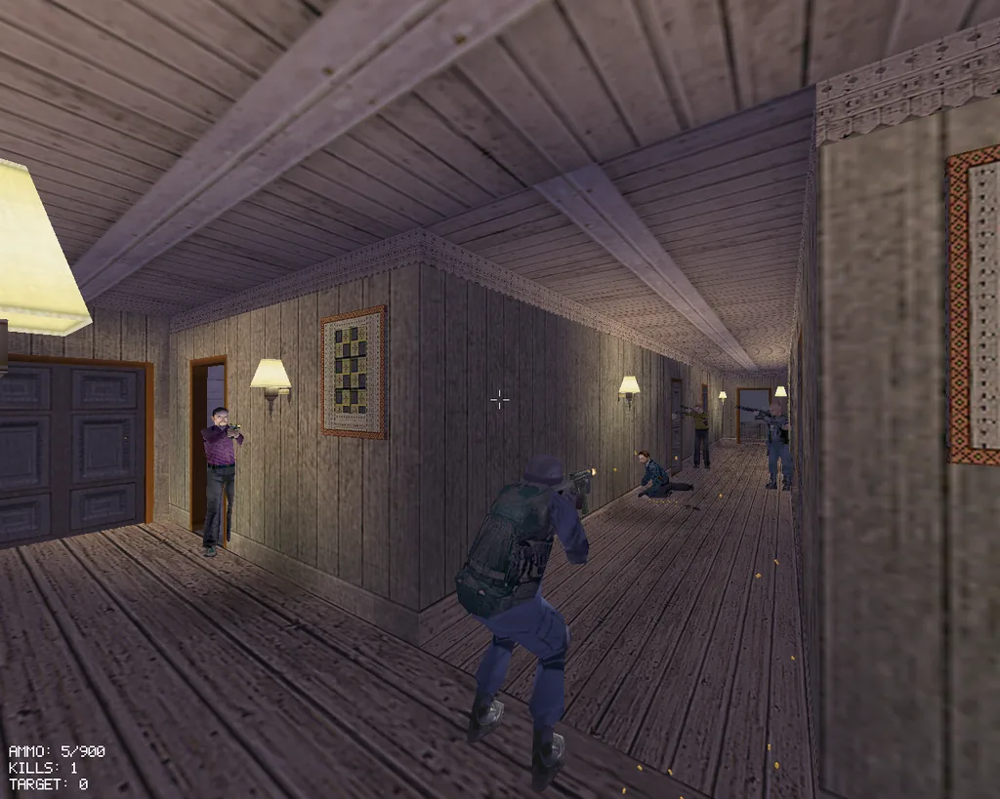
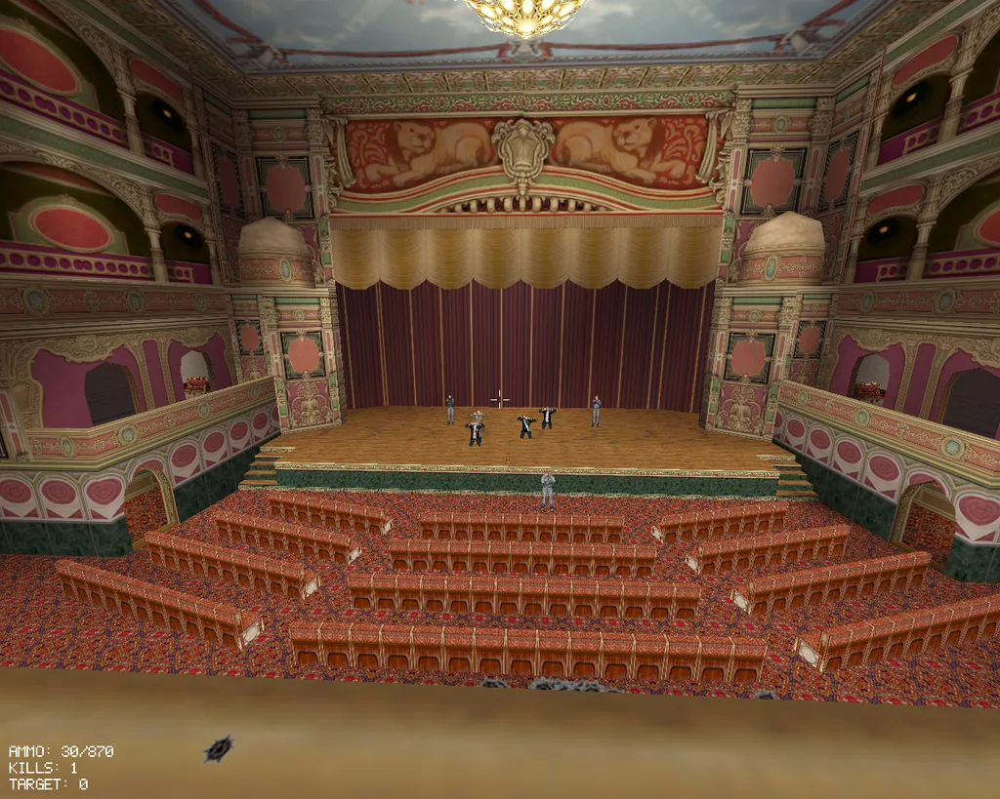
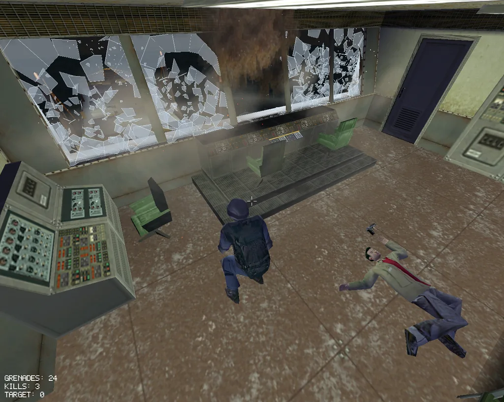
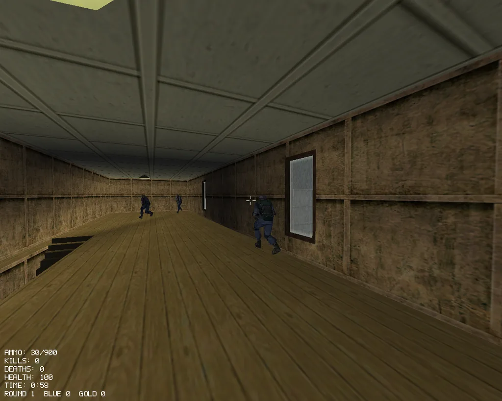
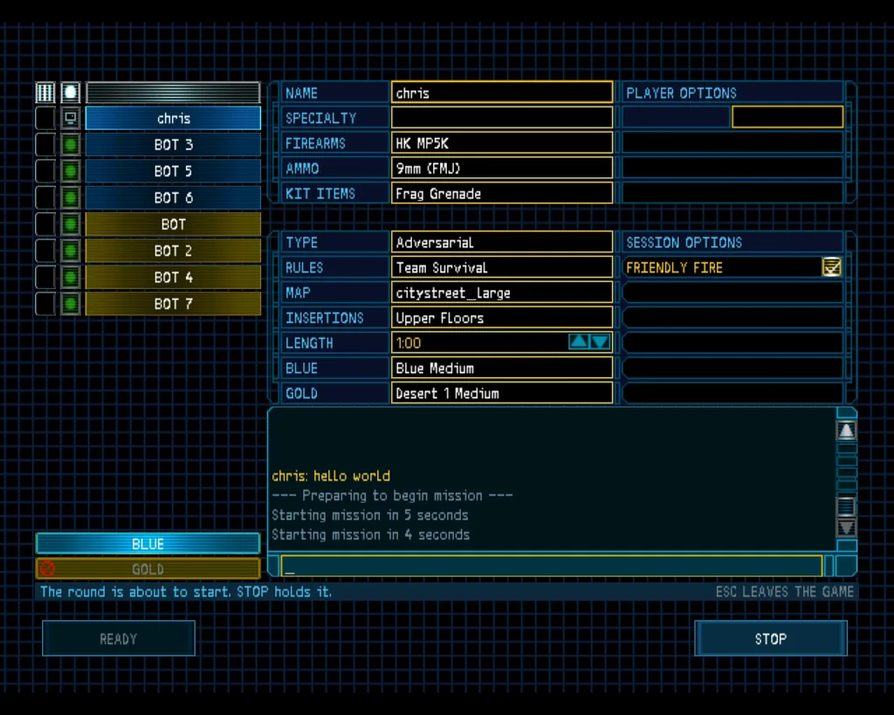
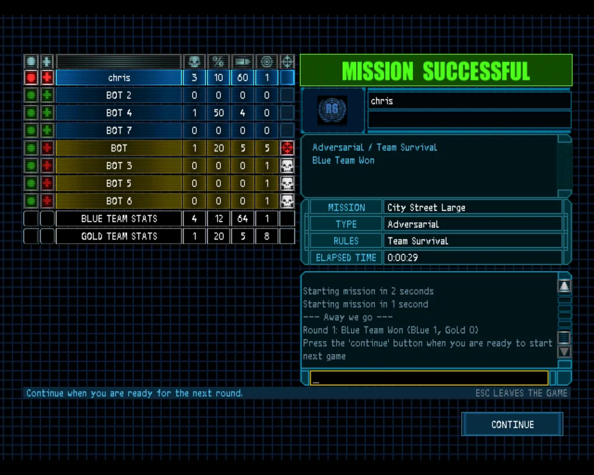

# rogue-reborn

A reimplementation of Tom Clancy's Rainbow Six: Rogue Spear, played from your own copy of the
game. The maps, textures, characters, animations and sounds all come straight from the original
data files.



## What works

Pick any of the original's missions and fight through it alone. The terrorists stand where the
mission puts them, and they shoot back. Or host a team game on a multiplayer map, against
friends or bots, in rounds that start from a lobby and end on a results screen.

In more detail:

- Levels drawn with the original's textures, rooms and portals, with collision, doors that open
  and glass that breaks.
- The original's gunfire: a spread that opens as you move and fire, damage by where a bullet
  lands, and the wound reactions. Frag grenades bounce, blast and break glass. More weapons are
  easy to add.
- The missions' terrorists, placed, dressed and armed as in the original. They wait in their
  stance, see and hear you by how alert they are, come to look at a noise, and turn and fire in
  bursts as their skill allows. Patrols and cover are still to come.
- Network play built the way Quake 3 did it. The server runs the game and sends each client only
  what changed. Every packet repeats your latest inputs, so a lost one costs nothing, and your
  own player moves at once. Play with bots, free for all or in two teams, in rounds of Team
  Survival or Survival.
- Recordings, also in the Quake 3 style: a client keeps every packet the server sent and plays
  the game back exactly. Single-player games record and replay too.

<p> </p>

## Game data

The game's data is not included. Copy the `data/` folder from your game install into the
repository root, next to `Cargo.toml`. The two maps and two faces in the repository are not
enough to see anything. [docs/development.md](docs/development.md) lists what each folder is
used for and how to pack a single level.

## Build

You need Rust (a recent stable, edition 2024) and CMake, because GLFW is built from source.

- **Windows:** install [w64devkit](https://github.com/skeeto/w64devkit), put its `bin` on your
  `PATH` and run `rustup target add x86_64-pc-windows-gnu`. The cargo aliases pass the target.
- **Linux:** `apt install cmake libxrandr-dev libxinerama-dev libxcursor-dev libxi-dev
  libgl1-mesa-dev`. Not tested recently.

## Play

```
cargo demo                                          # citystreet_large, first person, 30 grenades, god mode
cargo rr --level rm11 --first-person --textured     # any level, any options
cargo rr --list-levels                              # what is in data/map
```

Without the aliases: `cargo run --release --bin rr -- --first-person --textured`.

| Input | Action |
| --- | --- |
| W A S D, mouse | move, look |
| Left mouse | fire, hold for full auto |
| Right mouse (hold) | walk instead of run |
| Left Ctrl | crouch or stand |
| Q / E (hold) | peek left / right |
| Space or Backspace | open or close a door |
| R | reload |
| 1 / 3 | gun / frag grenade: hold left mouse to wind up, let go to throw |
| F | third-person view |
| Esc | quit |

| Option | Effect |
| --- | --- |
| `--level NAME` | pick a level by name |
| `--difficulty easy\|medium\|hard` | which terrorists the mission places |
| `--gamma N` | brighten the 3D world (1.6 is a good start) |
| `--realistic-decals` | bullet holes with splinters, sparks and dust |
| `--no-sound`, `--volume 0.0-1.0` | sound off, master volume |

[docs/development.md](docs/development.md) has all the options and the debug keys.

## Multiplayer

```
rr --host --level citystreet_large --name NAME --first-person --textured
rr --connect HOST:27960 --side blue --name NAME --first-person --textured
rrsrv --level citystreet_large --teams --rounds        # a dedicated server
```

Everyone waits in the lobby. Pick a side, ready up, and the round starts. Build `rr` and
`rrsrv` from the same commit.



To play alone against bots, `scripts/mp.sh` starts a server, the bots and your window:

```
scripts/mp.sh                              # the box room, three bots
scripts/mp.sh rm11 --bots 5 --skill hard   # a level, five hard bots
scripts/mp.sh rm08 --net bad               # a poor connection for you
```

<p> </p>

See [docs/multiplayer.md](docs/multiplayer.md) for how network play works.

## Layout

    src/sim/      the game: no clock, window or sound. Input in, Events out
    src/net/      server, client, wire format, rounds, recordings, lab
    src/main.rs   the client window, with its modules
    src/bin/      rrsrv (server), rrbot (bots), rrlab (fairness lab)
    docs/         design notes

`rr` is the client. `rrbot` plays bots over a real network. `rrlab` plays them over pretend
connections and measures how fair it was. More design notes are in
[terrorist-ai.md](docs/terrorist-ai.md) and [walking.md](docs/walking.md).

## Testing

    cargo wtest

The sim is deterministic and a test checks it. Recordings check themselves and can be kept as
tests. The lab's fairness figures are held by tests, so a change that makes play less fair fails.

Screenshots drive much of the rest. F2 saves a picture of the screen and a text file beside it.
The text file has where you stand, which way you look, the rooms around you, what you are
looking at, and a command that puts you back on the same spot. That pair is a complete bug
report. An LLM can read both, rerun the command, and check a fix against the same view, pixel
for pixel. F4 does the same for every frame over two seconds, for problems you only see in
motion. `scripts/shots.sh` and `scripts/golden.sh` render a fixed set of views and scripted runs,
so a change can be compared with the build before it.

## Credits

.MAP and .RSB parsing credit to [RSE-file-formats](https://github.com/AlexKimov/RSE-file-formats)
by Alexander Evdokimov. I adapted his 010 templates to Rust in 2023. As of 2026, frontier
LLMs can work out all the critical game formats in minutes.
